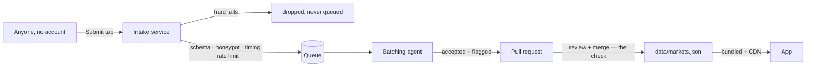

# Technical Requirements Document — Fresh Food Map

**Status:** v1 · **Last updated:** 2026-09-13 · Companion docs: [PRD](./prd.md), [Style guide](./style-guide.md), [intake service](../server/README.md)

## 1. What this is

A map of farmers markets. Three tabs — map, list, submit — one dataset, and a submission
pipeline that ends in a pull request.

**There are no accounts.** No sign-in, no roles, no permissions, no database of users.
Removing them removed most of the moving parts and nearly all of the security surface while
costing a user nothing: nobody ever needed an account to find a market, and submitting no
longer requires one either.

| Layer | Technology | Notes |
|---|---|---|
| App | Expo SDK 57 (React Native + TypeScript), Expo Router | One codebase → iOS, Android, web |
| Maps | `@maplibre/maplibre-react-native` (native), `maplibre-gl` (web) | Platform-split component, identical props |
| Tiles | OpenFreeMap | Free, no API key, no billing relationship |
| Geocoding | Nominatim (OSM) | Submit form and the `NEAR` search on both the list and the map, never on load. Forward lookups are biased by the device's position where there is one (`viewbox`, a ranking hint) and otherwise restricted to `EXPO_PUBLIC_GEOCODE_COUNTRIES` (default `us`) — without either, a bare postcode lands in the wrong country. Both directions — address to point, point to address. Free, no key. `EXPO_PUBLIC_GEOCODE_URL` is the origin, so a fork repoints both endpoints at its own instance |
| Display type | Fraunces via `@expo-google-fonts/fraunces` | Bundled; icons generated from the same TTF |
| Dataset | `data/markets.json` in git | Canonical. Bundled into the app, served from a CDN |
| Submissions | `server/` — Node, no framework | Validation, queue, batching agent |
| Queue | SQLite (default) or a file in the repo | Operational state only, never canonical |
| Hosting | Static export → any host, production at `freshfoodmap.app` (today the staging box answers there); intake service → a VPS | One-box staging stack: `Dockerfile`, `docker-compose.yml`, `Caddyfile`; the runbook for the box in use is unpublished |
| Tests | `node:test` + `node:assert/strict` through `tsx` | No test framework installed, and none should be |
| CI | GitHub Actions | typecheck, lint, dataset validation, unit tests, web build, DCO |

## 2. The dataset is the product

Everything else follows from this.

`data/markets.json` is a GeoJSON FeatureCollection, versioned in git, bundled into the app at
build time and optionally refetched from a CDN at runtime (`EXPO_PUBLIC_DATA_URL`; unset means
bundled-only, which is what a fresh checkout gets). It is the **only** tier. There is no database
holding markets, no cache to invalidate, and no server that discovery depends on.

Three consequences worth stating, because they are the reasons for the design rather than
side effects of it:

1. **Discovery works with no backend at all.** Clone, `npm install`, `npm run web`, and the
   map is populated. No account, no keys, no `.env`. A fork inherits that.
2. **The fallback for every failure is "a human edits a file."** No admin UI, no permissions
   system, no support ticket. This is what makes the submission pipeline safe to automate:
   the worst case is always recoverable by hand.
3. **The data outlives the app.** It is openly licensed and forkable on its own terms
   (ODbL — see `REUSE.toml`), so abandoning the app would not strand the dataset.

### Feature schema

Every feature is a `Point` (WGS84 lon/lat) with these properties. The contract lives in
`src/lib/market-schema.ts` and is imported by everything that validates — CI, the intake
service and the batching agent — so the three cannot drift apart.

| Property | Type | Notes |
|---|---|---|
| `id` | UUID | Stable across updates |
| `name` | string | 3–120 chars |
| `address` | string | Single-line display address |
| `schedule` | `{day, open, close}[]` | Up to 14 entries; empty is legal |
| `season_start` / `season_end` | `MM-DD` or null | Both or neither; null = year-round |
| `website` | https URL or null | Key required, value nullable |
| `source` | enum | `usda \| osm \| state_portal \| city_portal \| community \| manual` — provenance, for re-sync and for knowing what a re-import would overwrite. Not displayed anywhere, and never a trust signal |
| `source_ref` | string or null | Upstream ID for re-sync and attribution |
| `tags` | `MarketTag[]` | Closed vocabulary (`src/constants/tags.ts`) |
| `active` | boolean | Soft delete for closed markets |
| `country` | enum | `US \| GB \| JM` — a closed vocabulary (`src/constants/countries.ts`), because a code here is a promise the app can format that record's address, pick its unit and frame its map. It also narrows what a reader sees: `useMarkets` filters the dataset to the reader's country |
| `timezone` | IANA name | `America/New_York`, `Europe/London`, `America/Jamaica`. Validated by construction against `Intl.DateTimeFormat` rather than against a compiled-in list, which would be a second copy going stale against the platform's. It is what makes "open now" answer in the market's own time |

`scripts/validate-data.ts` parses the dataset with that schema, then checks the three things a
schema cannot: no duplicate ids, no two markets sharing a name within ~100m, and both season
dates set or neither. `MarketProperties` is a strict object, so an unknown key — a typo, or a
retired field re-added by an unpatched writer — is a loud error rather than a silent strip.
CI runs it, so bad data cannot merge.

No property in this table grades a listing, and no screen renders one. `source` is not shown
in the app at all: ODbL credit is discharged once for the whole collection, on the list
(`src/components/attribution.tsx`), because OSMF guidance is that attribution must not require
someone to interact with the work to see it — and a per-record line on the detail screen needed
a tap to reach. The field stays in the schema for re-sync and audit. What a market's presence
in the file does mean is §3.

## 3. What merging means

**Merging is the check: every market in `data/markets.json` is there because a person read the
pull request and merged it. There is no second state a listing can earn.**

`source` records where a record came from. It is provenance, not a ranking — no two values of
it mean more or less checked — and it is not even shown: the detail screen leads with the
market's name, then its tags, then where to find the stand, and the collection-level ODbL
credit sits on the list instead (§2). Anything that turns `source` into a badge, a rank, a
filter or a sort order is a per-listing grade by another name.

There is no verification UI, and not because there is no account system to gate one: there is
nothing left to gate. The review on the pull request is the check, and the merge records it.
What would otherwise be a second edit is the reviewer's obligation on the first one — say in
the pull request how you know.

## 4. The submission pipeline



Four properties this is designed around. Each is a constraint, not a nicety:

**No human decision happens on the server.** The service validates mechanically and opens
pull requests; every judgement call happens on GitHub. Reviewing is therefore not gated on
SSH access, and there is no single-person bottleneck.

**Auto-accept, never auto-reject.** An accepted submission still faces a human before
publication and that human is the only check, so a wrong accept costs a review comment. A
wrong reject is a silent deletion nobody sees. Exactly **three hard fails** are dropped —
honeypot tripped, submitted faster than a human reads the form, or a same-name-within-100m
duplicate the validator would reject anyway (`judge()` in `server/checks.ts`) — and a drop is
silent in both directions. The sender learns nothing: all three get the same
`202 {"status":"received"}` an accept gets, because naming the check a bot tripped is telling
it how to pass.

Nobody else learns anything either — nothing
is queued and no record of the drop survives the request, so a reviewer sees neither the
content nor a count of what was dropped. The `rejected` status in `server/store/index.ts` and
`retention_days.rejected` in `intake.config.json` were built for a tally that is not written,
which is why the startup line's rejected figure is structurally always zero. What a hard fail
does still cost the sender is quota: the rate-limit bucket is recorded before the checks run,
so rubbish is not free.

**Two outcomes are deliberately not silent, and they are not hard fails.** A payload that
misses the schema gets `422` with field-level issues, so a person who mistyped can see which
field; a bucket over the limit gets `429` with a message naming the pull-request route. This
section used to count both among the silent drops, which was wrong in the direction that
matters — it described a service that swallows a real person's mistake without telling them.

**Anything wrongly held is recoverable without server access**, because the data is a file in
a repository. A reviewer who disagrees edits the branch.

**Policy is versioned with the data.** Batch size, rate limits, dedupe radius and the flag
list live in `intake.config.json`, committed — so changing a spam threshold is a pull request
someone can object to, not something that happened on a server.

Operational detail — the queue backends, the proxy-header trap, IPv6 bucketing and IP
hashing — lives in [`server/README.md`](../server/README.md) rather than here.

## 5. Repository layout

```
fresh-food-map/
├── data/markets.json         # the dataset — canonical
├── docs/                     # trd, prd, style-guide
├── server/                   # submission intake service
│   ├── index.ts              #   HTTP endpoint
│   ├── checks.ts             #   hard fails and soft flags
│   ├── batch.ts              #   queue → pull request
│   ├── client-ip.ts          #   proxy handling, IPv6 bucketing, hashing
│   ├── config.ts             #   committed policy + env, checked at boot
│   └── store/                #   sqlite | github
├── src/
│   ├── app/(tabs)/           # index (map), list, submit
│   ├── app/market/[id].tsx   # detail
│   ├── components/           # map (platform-split), card, callout, week-strip,
│   │                         #   tag-filter, open-now-toggle, filter-toggle,
│   │                         #   market-search, clear-button, wordmark,
│   │                         #   attribution, external-link, page-title
│   ├── constants/            # theme.ts (tokens), tags.ts (vocabulary),
│   │                         #   sprout.ts (the mark: pin leaves + disc bars),
│   │                         #   source.ts (repo URL, correction issues)
│   ├── hooks/                # theme, colour scheme, location, focus-heading
│   └── lib/                  # markets, market-schema, submit, geo, geocode,
│                             #   callout-anchor, a11y
├── test/                     # node:test suites — §8
├── scripts/                  # validate-data, ingest/, gen-icons
├── intake.config.json        # intake policy, committed
├── Dockerfile                # intake + batching agent, one image, mode by env
├── docker-compose.yml        # profiles `persistent` | `ephemeral`, no default
├── Caddyfile                 # TLS, export at /, /intake/* proxied
└── .github/workflows/ci.yml
```

The dataset is `.json` rather than `.geojson` because Metro only bundles recognised
extensions; the content is standard RFC 7946.

`Dockerfile`, `docker-compose.yml` and `Caddyfile` are one deployment, not a platform. What
they are for is here; how the running box is built is in an unpublished runbook, because that
box is privately hosted and funded and its shape is not the public's business.

## 6. Platform

- **Web** — static export (`npm run build:web`, which also copies the dataset into `public/`
  so `EXPO_PUBLIC_DATA_URL` has something to fetch). Deep links to `/market/<id>` need the
  host's SPA fallback. `unstable_settings.initialRouteName` anchors stack routes to the tabs,
  so a deep-linked screen has a back button instead of an empty stack.
- **Mobile** — EAS for store builds (`eas.json`), with the data and intake URLs compiled in
  per profile and pointed at `freshfoodmap.app`. None has been built yet. MapLibre's native
  module is not in Expo Go, so contributors need a dev build.
- **PWA** — a manifest ships; the service worker does not. Not installable yet.
- **Staging** — one Ubuntu box: Caddy terminates TLS, serves the export at `/`, and proxies
  `/intake/*` to the service on a compose network. It adds no tier — the dataset is still git
  and the pipeline still ends in a pull request — it just gives the form somewhere to POST.
  Both queue backends can be run there and compared, which is the reason it exists. Profiles,
  env file and verification steps live with the runbook, which is not published. Until
  production exists the same box also answers for `freshfoodmap.app`: `/markets.json` and
  `/intake/*` directly, since those are what the store builds call, and a `308` to staging for
  everything else.

## 7. Security

The surface is small by construction, which is most of the argument for this shape.

- **No accounts, no sessions, no tokens in the client.** Nothing to steal from a browser.
- **The intake service holds the only secret** — a GitHub token, scoped to one repository
  with Contents and Pull requests write. It is never in the client bundle; anything prefixed
  `EXPO_PUBLIC_` is inlined into the app and must never hold a credential.
- **A submitter supplies facts, never provenance.** `id`, `source`, `source_ref` and `active`
  are absent from the submission schema and stripped if sent, so a payload cannot dress itself
  up as an OpenStreetMap import.
- **The intake token must not be able to merge into `GITHUB_BASE_BRANCH`.** Contents write is
  enough to commit straight to the base branch, so branch protection requiring a pull request
  there is part of the security boundary, not a preference: that path used to publish an
  unchecked row, and now it would mint a checked one (§3).
- **Rate limiting is per hashed IP bucket**, /64 for IPv6, and `X-Forwarded-For` is ignored
  unless a trusted proxy header is configured — a client can set it, and a limiter that
  believes it is decorative.
- **The geocoder sends a market's address one way and a coordinate pair the other**
  (`src/lib/geocode.ts`, Nominatim: `search` forward, `reverse` back). With the intake POST
  these are the only outbound calls the app makes besides fetching tiles and the dataset,
  all of them happen on a button press on the submit form and never on discovery, and none
  carries an identifier for the person pressing it — no cookie, no session, no device id,
  because none exists to send.

  The two directions sit differently against the privacy rule in
  [PRD §6](./prd.md#6-constraints--assumptions), and the difference is the point.
  `🔎 Find it from the address` does not touch it: that rule is about the *user's* location
  leaving the device, and this is the *market's* address, which the submitter is in the act
  of publishing anyway. **`📍 Use my current location` does touch it.** It reverse-geocodes
  the device's own GPS fix at six decimals, so the user's position leaves the device as a
  point rather than as a viewport — the one thing §6 said never happens. That is a real
  exception and is written here rather than reasoned away: it is on an explicit press, the
  coordinate is the one being published in the same submission, and it is sent bare. It also
  meant [`app.json`](../app.json)'s `locationWhenInUsePermission` string — "It never leaves
  your device." — overstated what the app does, and that string is a promise made at the
  moment somebody grants the permission. **It has been rewritten**, and now names both halves:
  what stays on the device (showing and sorting markets) and what does not (an address you
  look up). The `NEAR` search — the list's first, and on the map since — widened this again before the copy was fixed — a place
  somebody types is their own address as often as not — which is the argument for settling
  such copy in the change that makes it untrue rather than the one after. Recorded here so it stays a decision somebody made rather than one
  a reader discovers. A fork that wants no third party on this path points
  `EXPO_PUBLIC_GEOCODE_URL` at its own Nominatim; a fork that wants the button gone deletes
  it and the coordinate fields still work.
- **Everything reaching the dataset passes human review — that review is the only check the
  data gets**, and CI re-validates on the pull request.

## 8. Testing and CI

- **Dataset** — `validate-data.ts` on every pull request.
- **Typecheck and lint** — both. Note `tsconfig.json` names `expo/types` explicitly: the
  generated `expo-env.d.ts` is gitignored, so without it CI and a developer machine typecheck
  different programs.
- **Unit tests** — `npm test`, on every pull request: 389 tests across sixteen files. Node 22's
  built-in `node:test` runner and `node:assert/strict`, loaded through `tsx`; no test framework
  is installed and none should be. Files live in `test/`, `@/…` aliases resolve, and relative
  imports reach into `server/`. The script passes `--experimental-sqlite` for the same reason
  the service scripts do: the default queue backend *is* the runtime's `node:sqlite`, so there
  is no driver to install and none to stub.
- **Web build** — CI runs `expo export -p web`, so a broken build is caught before a deploy.
  It runs the bare export rather than `npm run build:web`: copying the dataset into `public/`
  is a deploy step, not a build step, and nothing in CI exercises it.
- **Branches.** Work happens on a feature branch, reaches `staging` by pull request, and `main`
  only after review — `staging` is therefore **ahead** of `main`, which is the opposite of the
  arrangement this repo started with. Both branches are protected and require a pull request;
  `main` additionally requires the `checks` job to pass, and both enforce on administrators, so
  there is no path to either that skips review. The workflow triggers on `pull_request` with no
  branch filter, which is why one job gates both hops without naming either.
- **Why the direction matters more than it looks.** Under the old arrangement `main` was where
  work landed and `staging` was promoted from it, so the environment meant to vet a change only
  ever saw changes that were already merged. Inverting it costs nothing mechanically — the same
  job runs on the same pull requests — and buys the thing the names always claimed: `staging` is
  where a change is seen running, `main` is what survived it, and a release tag cut from `main`
  is cut from reviewed work by construction rather than by discipline.
- **DCO** — every commit signed off, except pull requests that change only `data/`. The DCO
  is about copyright in contributed *code*; market records are facts under ODbL, contributed
  by people who never touch git.

### What the suite covers

Pure functions guarding invariants this document states elsewhere — chosen because two real
bugs shipped precisely where nothing checked them: `bucket()` threw a `RangeError` on any
IPv6 address containing `::`, unhandled inside an async handler, which would have taken the
whole intake service down on one submission; and the submit form keyed its error map
straight off zod's `schedule.0.open`, which no form field owned, so the message was shown to
nobody.

| File | Module under test | The promise it keeps |
|---|---|---|
| `test/market-schema.test.ts` | `src/lib/market-schema.ts` | One schema, three consumers. A submission that passes intake must not then fail CI. `MarketProperties` is strict, so a re-added `verified` key is a loud error. A submitter supplies facts, never provenance. |
| `test/checks.test.ts` | `server/checks.ts` | Never auto-reject: accepted *and* flagged both reach the pull request; only the three boring hard fails — honeypot filled, submitted faster than the minimum, same name within the dedupe radius — drop. Policy numbers are read from `intake.config.json`, never restated. |
| `test/batch.test.ts` | `server/batch.ts` | The agent assigns `id`/`source`/`source_ref`/`active` and overwrites anything a payload claimed; the proposed feature parses against the shared schema; the PR body says merging is the check. |
| `test/client-ip.test.ts` | `server/client-ip.ts` | No address shape takes the service down. A /64 is one submitter. A spoofed `X-Forwarded-For` cannot buy a fresh rate-limit counter, and a hashed bucket leaks no address. |
| `test/config.test.ts` | `server/config.ts` | A misconfigured deployment fails at boot rather than on somebody's submission. The env accessors are lazy on purpose, so `assertServiceEnv()` is the thing standing between a container with no `INTAKE_IP_SALT` and one that starts, reports healthy, and 500s on the first person to use the form. |
| `test/submit-errors.test.ts` | `src/lib/submit.ts` | Every validation error reaches somebody — placed on the input it came from, or said out loud when no input owns it. The wire payload carries facts only. |
| `test/schedule.test.ts` | `src/lib/submit.ts` | What the form holds becomes what the wire carries: the shared pair fans out to every selected day, an override replaces one day without disturbing the others, and an override cannot reach the payload while the switch is off. A day with half a pair is dropped rather than sent broken. The schedule is normalised to week order, so two people submitting the same market produce the same JSON however they tapped the chips — and the error mapping walks that same order. |
| `test/geocode.test.ts` | `src/lib/geocode.ts` | The usage policy is enforced in code, not in a comment: one request a second *shared across both directions*, an answered query never asked twice, and every request identifying the application. A lookup is never a dead end — every failure names the manual route. Neither a coordinate CI would reject nor an address longer than the schema allows reaches the form looking valid, and a coordinate cache key cannot answer an address query. Since UAT it also guards which address wins: `addressDetail` scores what the service found against what the reader typed, so `1573 w broad` is replaced by the full address while a tie or a vaguer answer leaves the typed words alone — the direction that loses data. And the composed form matches the dataset's own convention, `<street>, <city>, <ST> <zip>`, with the state abbreviated from the service's ISO code and the precision reported so a point with no house number is offered as a street rather than as an address. |
| `test/callout-anchor.test.ts` | `src/lib/callout-anchor.ts` | A summary card stays on screen wherever its pin is. The web's popup library picks an anchor for itself; the native `Marker` places the one it is given and never reconsiders, so the rule lives here and is asserted rather than eyeballed: above the pin where it fits, below it near the top, hooked to its own corner within half a card of a side, the roomier side when it fits neither way, and a sane answer before the card or the map has been measured. The failure it guards is silent — the card is simply half off the screen, and only for markets near an edge. |
| `test/sprout.test.ts` | `src/constants/sprout.ts` | One mark in two renderings — filled leaves on the pin, two bars on the filter disc — held together by the fact that each bar runs along its leaf's own diagonal. That is geometry stated in prose across three files, one of which (`scripts/gen-icons.js`) cannot import the other two, so it is asserted instead: each bar spans its leaf's tip and base, the View placement the toggle lays out with is genuinely derived from those endpoints rather than retyped beside them, the mark stays inside its 24-unit grid, the stem's path and its numbers describe one line, and the bars stay staggered rather than drifting into a symmetric V. |
| `test/report-url.test.ts` | `src/constants/source.ts` | The only repair route the app offers a reader still works when the market's name is full of URL punctuation: `Smith & Sons #2 / Tuesdays?` must reach the issue form whole rather than truncated at the first `&`. The id travels in the body because that is what a maintainer greps the dataset for, the template keeps its newlines, and a trailing slash on `EXPO_PUBLIC_SOURCE_URL` cannot produce the `//issues/new` that reads as a missing repository. |
| `test/markets-geo.test.ts` | `src/lib/geo.ts`, `src/lib/markets.ts` | Distance maths, the box NEAR ME frames, and the list screen's filtering, sorting, formatting and open-now: `boundsAround` holds every point it was handed and returns a box never narrower than its floor, so standing at the market does not arrive at maximum zoom on an empty street; a second tag narrows and never widens; sorting never mutates the caller's array, reverses inside the comparator so markets it cannot tell apart keep their order in both directions, and stays human-alphabetical rather than code-point ordered whichever way it runs; a market with no hours listed is never open; a season running November to March wraps the new year instead of matching nothing; and `availableTags` answers which tags the *dataset* has — never which survive the filters somebody has set, which is the distinction that decides whether a chip is hidden or merely greyed. |

### What it does not cover

- **No component or rendering tests.** Nothing mounts a screen, so anything that only goes
  wrong once React is involved — layout, focus, an accessibility prop react-native-web
  quietly drops (`src/lib/a11y.ts` exists because of that class of gap) — is invisible here.
  `featureToMarket` and `parseCollection` are exported from `src/lib/markets.ts` for exactly
  this reason: the unknown-tag drop and the
  `active !== false` drop are invariants worth pinning, and a function only a hook can reach
  is a function nothing can check.
- **Browser behaviour** — the map, permission prompts, the real form — is checked by driving
  the running app with Playwright during development, and accessibility with axe-core against
  the routes plus the ARIA snapshot rather than the DOM one, which will happily tell you a
  hidden element is still exposed. Neither is in CI and there is no headless browser in the
  pipeline.
- **Nothing that needs a network, a running service, an ambient env var, or the real clock.**
  A test that cares about environment sets it and restores it (`config.test.ts`,
  `submit-errors.test.ts`); `isOpenNow` takes `now` as a parameter precisely so nothing has to
  read the wall clock. Genuinely untested: the intake HTTP layer's status codes are covered
  from the client side only, and `server/index.ts` wiring, the SQLite and GitHub queue
  backends' failure paths and the CLI wrappers are not covered at all.
- **Third-party behaviour** — zod, Node, Expo — is never asserted. The tests check this
  code's decisions.

## 9. Budgets

- Bundled dataset ≤ 2 MB raw. At the ~800 bytes per feature the file currently averages,
  that is about 2,600 markets; beyond it, region-split files.
- Map interactive < 3 s on mid-range Android over 4G. Pin clustering above ~200 in-viewport
  points — not built.
- Web bundle (gz) < 1.5 MB initial route.

## 10. Risks

| Risk | Mitigation |
|---|---|
| OpenFreeMap terms change | Style URL behind one constant; Protomaps PMTiles on R2 as fallback |
| Intake service down | Discovery is unaffected — it is static. Submissions fall back to a pull request |
| Queue lost on redeploy | SQLite must sit on persistent disk; the repo-backed store exists for hosts without it |
| Submission spam | Mechanical checks, rate limiting, and human review before anything publishes |
| Merge implies a check nobody performed | Keep pull requests readable — batch size in `intake.config.json`, imports small enough to review row by row |
| Dataset outgrows the bundle | Region-split; the budget above is the trigger |
| A market record predating the `timezone` field | **The risk this replaces is closed**: "open now" was judged by the device clock, and the schema now carries an IANA zone per market that `marketClock` reads, so the answer is given in the market's own time. What is left is the version skew — a dataset refetched from the CDN can be older than the app reading it, and a record with no zone falls back to the device rather than refusing to answer |
| SEO on react-native-web | Accepted for now; static market pages from the same GeoJSON if it matters later |
